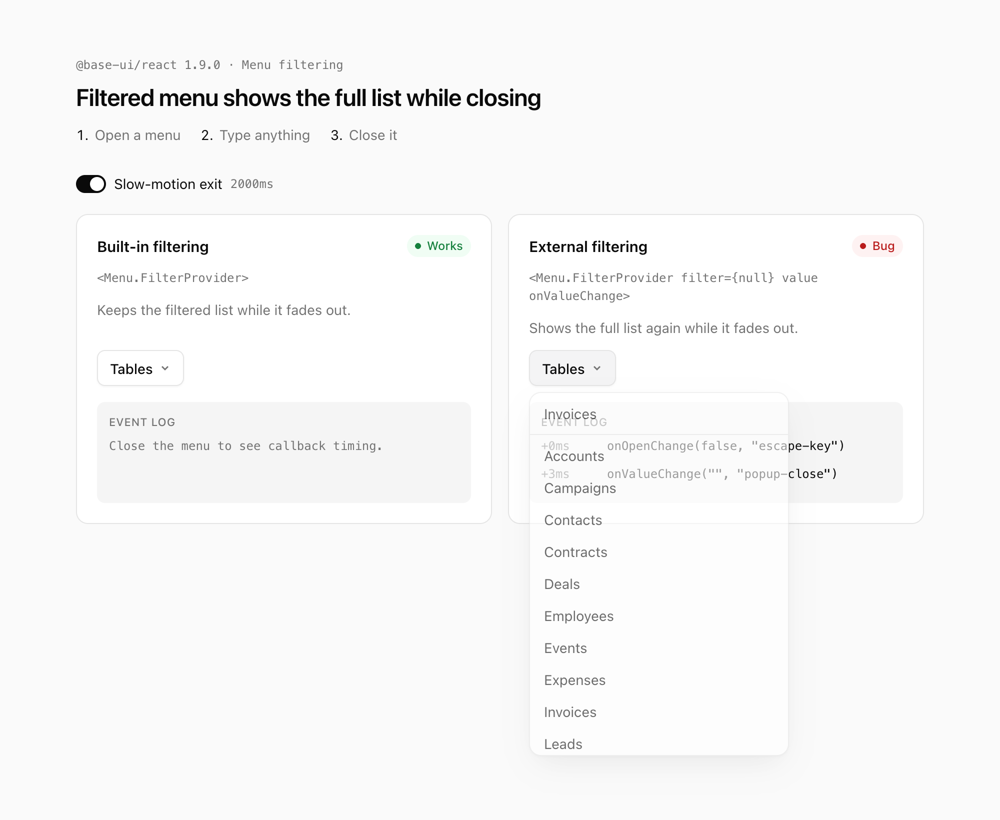

# Base UI: `filter={null}` Menu shows the full list while closing

Reproduction for a `@base-ui/react` 1.9.0 bug. A filterable menu that renders its own results (`<Menu.FilterProvider filter={null}>`) shows its unfiltered list during the exit transition.

[Open in StackBlitz](https://stackblitz.com/github/arshad-yaseen/base-ui-menu-filter-close-flash)



## Run locally

```sh
npm install
npm run dev
```

## Steps

1. Open either menu and type anything.
2. Close it: press <kbd>Esc</kbd>, pick an item, or click outside.

| Menu | Setup | While fading out |
| :-- | :-- | :-- |
| Built-in filtering | `<Menu.FilterProvider>` | Keeps the filtered list |
| External filtering | `<Menu.FilterProvider filter={null} value onValueChange>` | Shows the full list again |

The "Slow-motion exit" switch, on by default, stretches the 200ms fade-out to 2s so the jump is easy to see. The bug also happens at 200ms.

All the code is in [`src/App.tsx`](./src/App.tsx).
